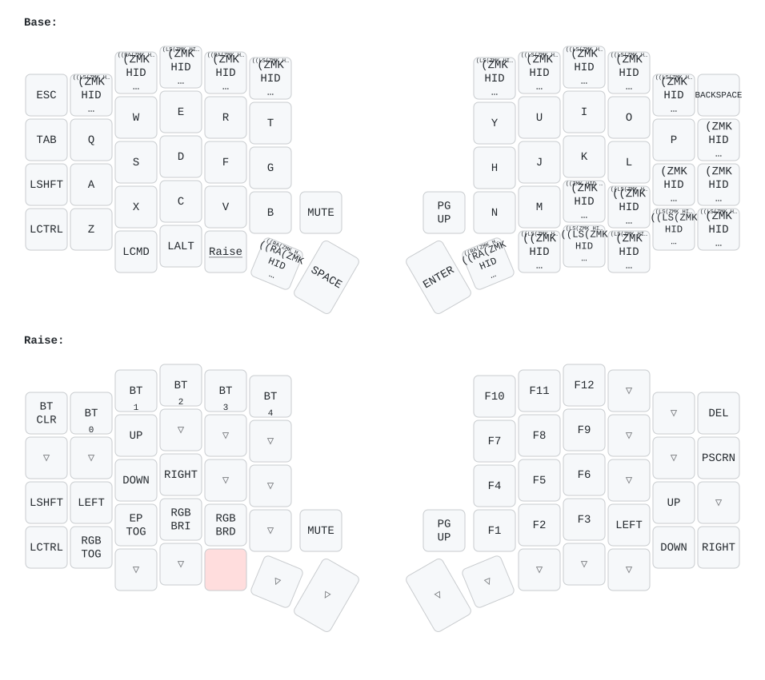

# Aurora Sofle v2 — ZMK config (Swedish layout + TPS65 touchpad)

ZMK firmware for a [splitkb Aurora Sofle v2](https://splitkb.com/products/aurora-sofle)
wireless split keyboard.

- **Controllers:** nice!nano v2 (nRF52840), one per half
- **Left half:** central. It talks to the host over BLE/USB and has the OLED,
  which shows the stock ZMK battery widget (left half's battery only).
- **Right half:** peripheral. It carries an **Azoteq TPS65 (IQS5xx) touchpad**
  on I2C in polling mode (16 ms, no RDY pin since the PCB has no spare pin).
  Its OLED is disabled to free the I2C bus.
- **Layout:** Swedish (`config/keys_sv.h`) with US-style shifted symbols via
  mod-morphs; 2 layers (Base, Raise)
- **Encoders:** volume down/up (left), undo/redo `Ctrl+Z`/`Ctrl+Y` (right)
- **Lighting:** per-key RGB + underglow on one chain, off at boot (underglow
  can't be turned off separately, see [Unsolved goals](#unsolved-goals))
- **Power:** deep sleep is disabled (`CONFIG_ZMK_SLEEP=n`) for reliable split
  reconnects, so the halves drain their batteries faster when idle
- **Touchpad driver:** vendored in-tree under `drivers/input/` (fork of
  [AYM1607/zmk-driver-azoteq-iqs5xx](https://github.com/AYM1607/zmk-driver-azoteq-iqs5xx)
  with polling-mode support)

## Repo status

The config matches commit `c0652b0` (June 2026), the firmware that has
worked best on the hardware. The August 2026 changes (driver rework, 400 kHz
I2C, custom dual-battery OLED screen, extra BLE settings) were rolled back
because they made the keyboard worse.

Two things were kept from August because they don't change the firmware:

- **`config/west.yml`** pins ZMK to `ff09f2d`, which was ZMK `main` when the
  June firmware was built. Builds therefore reproduce that firmware instead
  of tracking whatever `main` is today. Bump it on purpose, as its own
  commit, and test before relying on it.
- **`.github/workflows/build.yml`** creates a release on manual runs too and
  uses `softprops/action-gh-release@v3`.

### Unsolved goals

The August work had two goals. Neither worked, and both were rolled back:

1. **Show the right half's battery on the left OLED.** The right half has the
   touchpad and no working display, so its battery level is invisible. The
   attempt used a custom status screen and
   `CONFIG_ZMK_SPLIT_BLE_CENTRAL_BATTERY_LEVEL_FETCHING`. The code is still in
   git history (commit `2ebb568`) if someone wants to try again in isolation.
2. **Turn off the underglow LEDs and keep the per-key LEDs.** Underglow and
   per-key LEDs share one LED chain (`chain-length = <35>`, 29 per-key + 6
   underglow). Shortening the chain to 29 darkened the bottom row of per-key
   LEDs instead, because that row sits at the end of the chain. Underglow can't
   be dropped that way, so it still lights up together with the per-key RGB.

Other things tried in August that didn't work on this hardware:

- 400 kHz I2C on the right half: severe touchpad lag
- `CONFIG_ZMK_BLE_EXPERIMENTAL_SEC`: Windows asked for a passkey during pairing
- `bottom-beta = 5`: felt worse than 2

## Building

Firmware builds on GitHub Actions on every push to `master` (or manually via
*Actions → Build ZMK Firmware → Run workflow*). Each successful `master` build
publishes a dated release with three files:

| File | Flash to |
|---|---|
| `splitkb_aurora_sofle_left-nice_nano.uf2` | left half |
| `splitkb_aurora_sofle_right-nice_nano.uf2` | right half |
| `settings_reset-nice_nano.uf2` | both halves, only when re-pairing (see below) |

## Flashing

1. **Switch the other half OFF** before flashing. USB-C also powers a half
   even when its switch is off.
2. Double-tap the reset button to enter the bootloader; the board mounts as a
   `NICENANO` USB drive.
3. Copy the matching `.uf2` onto the drive. It reboots itself when done.

## When the halves won't connect to each other (re-pairing the split)

The left↔right pairing is separate from the host pairing, so `BT_CLR` does
**not** fix it. Full reset procedure:

1. Charge **both** halves via USB-C first. Deep sleep is disabled, so an idle
   half drains its battery in days, and a flat right half looks exactly like
   "won't reconnect".
2. Flash `settings_reset-nice_nano.uf2` to **both** halves (one at a time,
   other half off).
3. Flash the real left/right firmware back onto each half.
4. Power both halves on at roughly the same time and let them bond.
5. Remove any old "Aurora Sofle" entry from the host's Bluetooth settings,
   then pair again from the host.

## Raise layer controls

Hold the Raise thumb key (`MO(1)`, third left thumb key):

- `ESC` position → `BT_CLR`: clears the **currently selected host profile
  only** (not the split pairing, not other profiles)
- Number row `1..5` → select host profile 0–4
- Bottom row: `RGB_TOG`, `EP_TOG` (ext-power toggle), `RGB_BRI`/`RGB_BRD`

## Touchpad

Settings live in `config/splitkb_aurora_sofle_right.overlay`:

- `poll-interval-ms = <16>`: polling cadence
- `bottom-beta = <2>`: slow-speed filtering (0 = smoothest/laggiest,
  255 = most responsive)
- `stationary-threshold = <2>`
- `flip-x`, `flip-y`, `switch-xy`: axis mapping for the vertically mounted pad

Gestures: one-finger tap = left click, two-finger tap = right click,
press-and-hold (250 ms) = drag, two-finger drag = scroll (natural Y).
